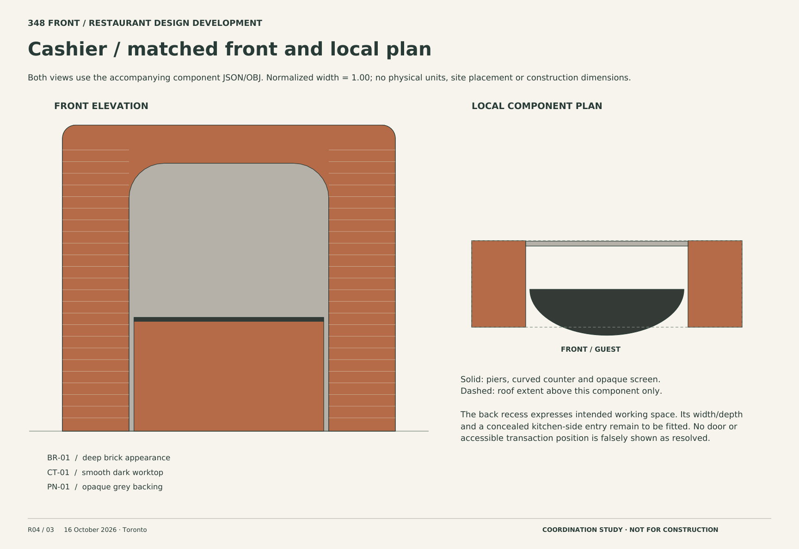
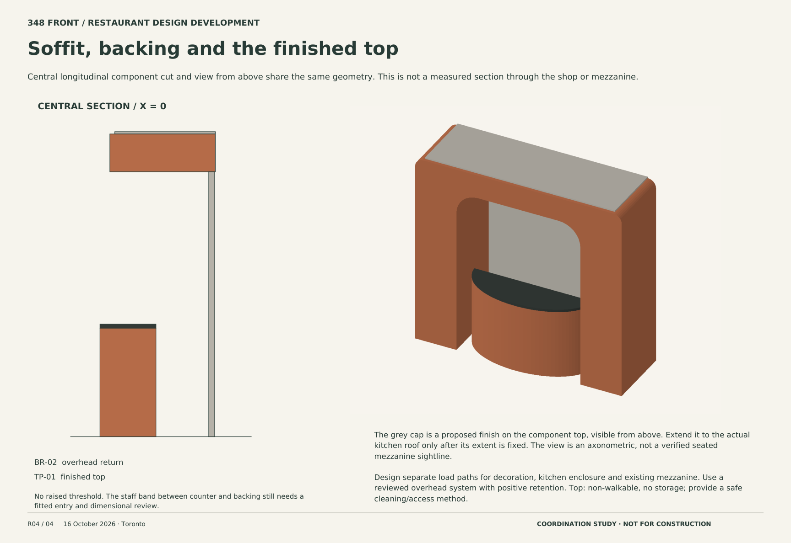
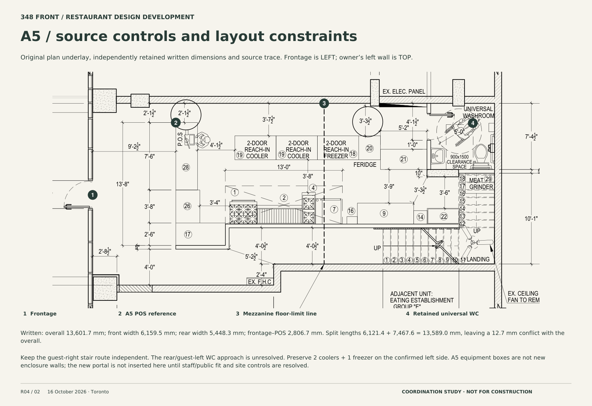

# R04 — approved brick design development

16 October 2026 · Working documents: 352 Front Street West, Unit 105 · Customer entrance: 348 Front Street West.

The owner selected the compact R03 V02 appearance. R04 develops it into matching technical views, an editable A5 reference and finish/service schedules. The original R03 PDF/PNG remain unchanged in the parent folder.

**[Open the eight-page design PDF](R04_Design_Development.pdf)** · **[Download the CAD/model package](R04_CAD_and_Design_Records.zip)**

If GitHub's preview is unavailable, use the file's download button. Stay signed into the GitHub account with access to this private repository. The PDF is below 5 MB; every individual file is below 40 MB.

## Drawings you can view here

Matching front elevation and local component plan:

Section and view of the finished top:

A5 source controls and unresolved public-WC connection:

## What is editable

- `R04_A5_Reference.dxf`: A5 source ink in nominal model millimetres at 1:1, derived from the source's 1:64 print scale. Do not scale it by 64 again. It is a reference trace, not a measured survey or a fitted proposal. SVG preserves the source appearance; DXF text/font substitution may differ. Cubic curves in DXF are approximated to a documented 0.5 mm source-trace tolerance.
- `R04_Portal_Component.obj` + `.mtl` + `.json`: one shared component behind the matching views. **Unitless normalized width = 1.00; physical_scale_mm = null. Do not import as metres or millimetres.** The component is kept separate from the A5 plan. The meshes represent finish envelopes, not fabrication/support details.
- Planning basis, source controls and the detailed finish/lighting/operation schedule are included as Markdown/JSON. Build and extraction scripts are included for traceability; rebuilding needs the original A5 PDF retained in the cloud workspace.

The top is deliberately finished but non-walkable and not for storage. Actual kitchen-roof extent, site heights, staff entry, accessible transaction, seating/queue fit, public-WC route and support still need the listed site/design controls. No construction dimensions, products, permits or procurement are released by visual approval.

Current baseline retains the ground universal WC. Future storage/extra upstairs WC remains a separate conditional scenario. Refrigeration remains two two-door coolers and one two-door freezer on the left when entering. Only ground-floor tile/adhesive removal has been reported. No new budget total is introduced.

## iPhone access

The same Codex task opens in Safari on the same iPhone/account/workspace, while all Codex tasks fail in the native app. **Safari is the confirmed working phone route:** https://chatgpt.com/codex .

Check for a ChatGPT update in the App Store. If the app still fails, sign out and sign back in with the same account/workspace. Restarting and force-closing have already been tried and need not be repeated. The exact cause is unconfirmed.

If it persists, use [the support copy-text](iPhone_Task_Open_Diagnostic_2026-10-16.md#support-copy-text) with your app/iOS versions at https://help.openai.com/ . No support message has been sent for you.
