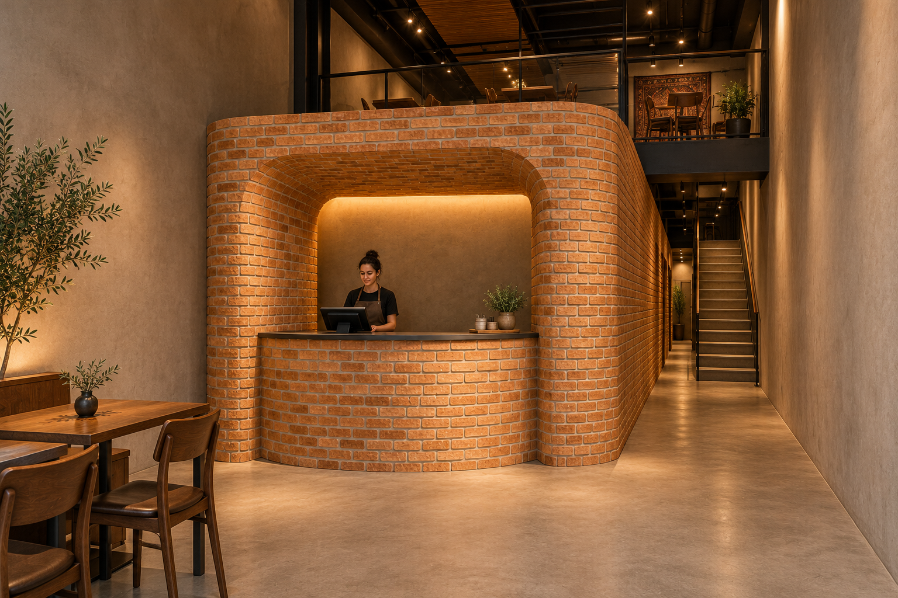

# R05 — View from the entrance

16 October 2026 · 348 Front Street West, Toronto.

This view develops your approved brick design inside the restaurant: a compact curved cashier in front of the enclosed kitchen, continuous brick returns, the independent passage on the right, and the rear stair/mezzanine. Concrete-look flooring, quiet mineral-grey walls, warm wood seating and restrained Persian textile carry your material brief into the room.

**[Open/download the full-size PNG](R05_Entrance_POV.png)** · **[Open the one-page PDF](R05_Entrance_POV.pdf)**

Entrance concept based on A5 and your site photos. Heights, the exact mezzanine relationship, staff access and working clearances remain illustrative. This is an AI-generated design proposal, not a photograph of completed work or a measured CAD rendering. Original source files and R03/R04 issues remain unchanged.
